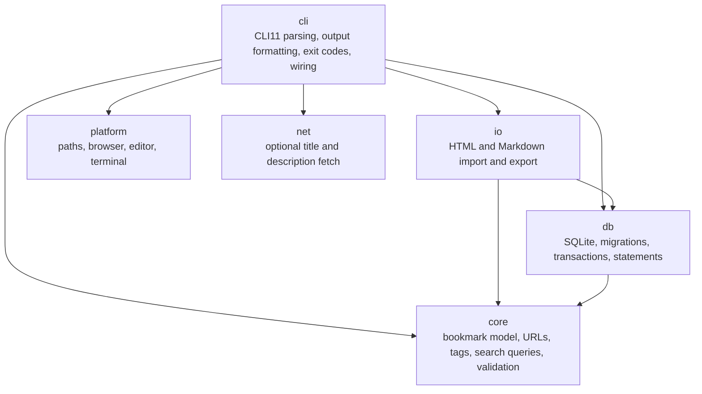
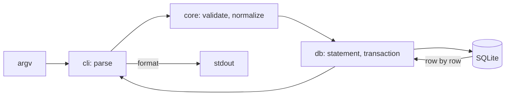

# Architecture and Development Guide

## 1. Purpose

This document is the architectural contract for BuCu: its stack, modules, contracts, data flow, and coding, testing, and portability standards. CLI behaviour is in `docs/product.md`; stored data in `docs/database-schema.md`. When to read this document and how it changes: `CLAUDE.md`.

Normative words (MUST, SHOULD, MAY): [constitution §6](constitution.md#6-normative-language).

Sections marked "(added by #N)" describe a part that issue #N builds. Until that issue merges, the section states the agreed design, and the issue's plan can refine it.

---

## 2. Stack

| Dependency | Role | Licence | Why |
| --- | --- | --- | --- |
| C++23; minimum compilers GCC 13 and Clang 19 (Apple Clang 17 from Xcode 16.4, MSVC 19.51) | Language | — | Native speed and startup; `std::expected` for typed errors (§7) |
| CMake ≥ 3.25 with `CMakePresets.json` | Build | — | The common denominator for the three toolchains; presets give one command per build type |
| SQLite amalgamation, vendored in `third_party/sqlite/` (FTS5 on) | Storage | Public domain | One known version and feature set on every platform. `BUCU_USE_SYSTEM_SQLITE=ON` links the system library instead, for distribution packagers ([ADR 0004](adr/0004-vendored-dependencies.md)) |
| CLI11, vendored | Argument parsing with subcommands | BSD-3-Clause | Header-only, subcommand support, generated help, no other dependency |
| Unicode Character Database casing tables, generated into `third_party/unicode/` | Tag lowercasing in `core` without ICU | Unicode License V3 | Buku lowercases tags with Python's `str.lower()`; a generated table gives the same result on every platform with no dependency. `scripts/update-deps.sh` pins the source and generated files by SHA256 |
| libcurl, system library; Windows source settled by #16 | Optional title and description fetch (`src/net/`) | curl (MIT-style) | The portable HTTP and TLS client with timeouts and size limits; behind `BUCU_WITH_NET` ([ADR 0005](adr/0005-libcurl-networking.md)) |

Test and quality tools:

| Tool | Role | Why |
| --- | --- | --- |
| Catch2 v3, vendored amalgamated | Unit, integration, and golden-file tests; micro-benchmarks | Two files to vendor; sections, generators, and matchers; built-in benchmarking. Chosen over doctest (fewer matchers, no benchmarks) and GoogleTest (heavier to vendor) |
| ctest | Test runner across platforms | Ships with CMake |
| clang-format | Formatting authority (`.clang-format`) | |
| ccache | Compiler cache in CI only; not linked into BuCu | Keeps the matrix fast; local builds stay free of it |
| clang-tidy | Static analysis (`.clang-tidy`), focused checks only | |
| AddressSanitizer, UndefinedBehaviorSanitizer, ThreadSanitizer | Memory, undefined-behaviour, and data-race checks | Presets `asan-ubsan` and `tsan`, where the compiler supports them |
| hyperfine (optional) | Command-line benchmarks | `scripts/bench.sh` falls back to a portable timer |

Each vendored dependency lives in `third_party/<name>/` with its licence file and a `VERSION.txt` file, and `scripts/update-deps.sh` refreshes it. No other dependency is allowed without a plan decision (constitution §4). The choice of this stack: [ADR 0001](adr/0001-cpp20-cmake-sqlite.md).

Platforms: Linux x86-64 (GCC, Clang), macOS ARM64 (Apple Clang), Windows x86-64 (MSVC). BSD is a goal (#30). The CI matrix: `.github/workflows/ci.yml`. The issue that adds the first thread adds the `tsan` entry.

---

## 3. High-level architecture



`cli` creates the platform and network implementations and passes them, as interfaces, to the code that needs them. Module structure: [ADR 0002](adr/0002-module-layout.md).

---

## 4. Module responsibilities

Each module is a CMake library target under `src/<module>/`, with its public headers in `include/bucu/<module>/`. The target graph enforces the direction in §3. A module's target is created with its first source file.

| Module | Owns | MUST NOT |
| --- | --- | --- |
| `core` | Bookmark model, URL validation and normalization, tag parsing and operations, search query parsing, validation errors | Include SQLite, CLI11, libcurl, or any operating-system header; read the clock or the environment (receive them as parameters) |
| `db` | Connection setup, schema migrations, prepared statements, transactions, repositories that stream rows | Format output; parse command lines; contain rules that belong in `core` |
| `io` | Import and export formats over streams, one transaction per import | Load a whole file or result set into memory; open files by itself (receive streams) |
| `net` | The fetch interface and the libcurl implementation, timeouts, size caps | Be required by any other module; run unless asked (constitution principle 8) |
| `platform` | Data directory, browser launch, editor launch, terminal detection and colour, UTF-8 console | Contain business rules |
| `cli` | Subcommands, options, output formatting, pagination, exit codes, wiring of the implementations | Run SQL directly; contain rules that belong in `core` |

Moving a responsibility needs an ADR (constitution §4).

### 4.1 Repository layout

```text
CMakeLists.txt, CMakePresets.json
include/bucu/<module>/  # public headers (module contracts, §5)
src/<module>/           # module sources
tests/                  # Catch2 tests: unit, integration, golden files
benchmarks/             # datasets, harness, results (docs/performance.md)
third_party/            # vendored dependencies with licences (§2)
scripts/                # format, bench, update-deps
docs/                   # living documents
docs/adr/, docs/contracts/
tools/                  # SDD workflow tools (CLAUDE.md Commands); not part of BuCu
.claude/                # agent skills and hooks (SDD workflow); not part of BuCu
.githooks/              # git hooks, enabled with core.hooksPath; not part of BuCu
.github/workflows/      # CI
```

---

## 5. Key contracts

Each contract has three parts: its rules (linked below); one record for each version change in [`docs/contracts/`](contracts/), never edited after merge, which is its history; and the code or files that hold its exact current shape. Start a record from [`0000-template.md`](contracts/0000-template.md).

| Contract | Rules | Records | Exact shape |
| --- | --- | --- | --- |
| Database schema | [`docs/database-schema.md`](database-schema.md) | `db-NNN` (number = `PRAGMA user_version`) | `src/db/migrations.cpp` |
| Export formats | product §7 | `export-NNN` | One sample file per format version, read by the import tests (added by #17) |
| Module contracts | §4 | `module-NNN` | The headers in `include/bucu/` and the tests that lock them |

---

## 6. Data flow



- Queries stream rows to the formatter one at a time; no command holds a whole result set.
- Domain rules receive plain values and return plain values or errors.

---

## 7. Error handling

- Expected failures (invalid input, a missing bookmark, a malformed import file, a constraint violation) MUST return a typed error (`std::expected`) that `cli` maps to a message and an exit code (product §6).
- An import validates as it streams, inside one transaction; a failed import changes no data.
- Writes that change more than one table run in one transaction.
- Do not catch `...` or `std::exception` without handling it. Broad silent handlers are prohibited.

---

## 8. Coding standards

- **Formatting:** clang-format is the authority. **Analysis:** clang-tidy with the checks in `.clang-tidy`.
- **Warnings:** every BuCu target builds with the strict set, and warnings are errors in every preset and in CI (`BUCU_WERROR`, `ON` in every preset, `OFF` by default in `CMakeLists.txt` so a packager's newer compiler does not break the build).
  - GCC and Clang: `-Wall -Wextra -Wpedantic -Wconversion -Wsign-conversion -Wshadow -Wold-style-cast -Wnon-virtual-dtor -Woverloaded-virtual -Wcast-align -Wnull-dereference -Wdouble-promotion -Wformat=2 -Wimplicit-fallthrough`.
  - GCC only: `-Wduplicated-cond -Wduplicated-branches -Wlogical-op -Wuseless-cast`.
  - MSVC: `/W4 /WX /permissive-`, with `/external:anglebrackets /external:W0` for third-party headers.
- **Third-party code:** vendored headers (CLI11, Catch2) are included as `SYSTEM`; vendored sources (the SQLite amalgamation) build in their own target without the strict set. The strict set never weakens for BuCu's own code, tests included.
- **Suppressions:** silence a warning only at the narrowest scope (one line or one function, never a file or target), with a comment that names the warning and why the code is correct. Do not cast just to quiet a warning.
- **Ownership:** RAII for every resource (SQLite handles, files, processes). No owning raw pointers. `std::string_view` where ownership is not needed, and never stored past the life of its source.
- **Hot paths:** avoid needless allocations; measure before adding caches, custom allocators, or complex structures (`docs/performance.md`).
- **Text:** UTF-8 in `std::string` everywhere. Convert to UTF-16 only inside `src/platform/` on Windows.
- **Platform code:** `#ifdef` on the operating system only in `src/platform/` (constitution principle 9).
- **Naming:** `snake_case` functions and variables, `PascalCase` types, `kPascalCase` constants, namespaces `bucu::<module>`. `.clang-tidy` enforces them.
- **Comments:** when a code comment or test name cites a source, it cites an issue, a living-document section, or an ADR, never a task or criterion ID from an issue body.

---

## 9. Testing standards

| Layer | Tests |
| --- | --- |
| `core` | Unit tests for every rule in product §4, including error paths |
| `db` | Integration tests on temporary database files: migrations from each version, CRUD, transactions, cascades |
| `io` | Round-trip tests and malformed-input tests with fixtures written for BuCu |
| `cli` | Argument handling, exit codes, and golden-file tests of stable output |
| `platform`, `net` | Tests through fakes of the interfaces; no real browser, editor, or network in CI |

- Tests MUST NOT depend on the machine's clock, locale, time zone, home directory, or network. Inject them.
- Every bug fix has a regression test (constitution §3).
- Test behaviour, not implementation details.
